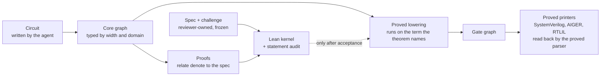
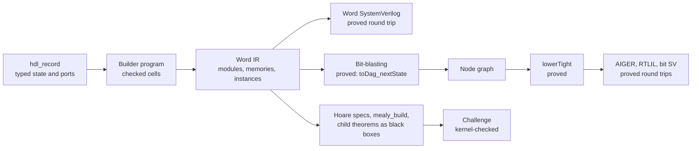

# HDLean: a Lean 4–embedded HDL for LLM agents

Design specification v0.3 · Oct 16, 2026 · @Nathan

This file mirrors the shared design document. Implementation status is tracked in [Status.md](Status.md) and implementation choices in [Decisions.md](Decisions.md).

## 1. Status, scope and how to read this spec

HDLean is a hardware description language embedded in Lean 4. LLM agents write the hardware and its proofs; humans review only short, readable specifications. This is version 0.3. v0.2 revised the design after reviewing the first implementation (nathsou/HDLean PR #1; findings in 15.5). v0.3 records the consolidation that followed: one pipeline, the official Lean kernel only, readable challenge files, and proved-parser read-back instead of byte certificates (sections 12, 13.4 and 16). The project was first drafted as "Proofwire".

Design statements carry one of three markers:

- **Principle**: a commitment. It changes only through an explicit revision of this document, with the reason recorded.
- **Decision**: the current choice. It may change during implementation, for example when it makes theorems hard to state or prove. Changes go in the decision log (section 15).
- **Open**: not decided yet. The options are listed.

|  | In scope for v1 | Out of scope for v1 |
| --- | --- | --- |
| Logic | Synchronous digital logic, one or more clock domains | Asynchronous and self-timed logic, latches |
| Crossings | Clock-domain crossings through verified primitives only | Hand-written synchronizers outside the framework |
| State | Resettable and non-resettable registers; memories as primitives | Tri-state and bidirectional nets, except top-level vendor primitives |
| Clocks | Independent clocks supplied by the environment | Clock gating, generated clocks (later, as audited primitives) |
| Correctness | Refinement of reference models, contracts, bounded progress | Unbounded liveness |
| Performance | Cycle-level theorems, structural bounds, measured physical metrics | Proofs about physical delay, power or area |
| Outputs | SystemVerilog subset, AIGER, RTLIL | Vendor-specific netlists |

Three roles use HDLean:

- **Agent**: writes implementations, proofs and scenario traces. It may draft specs but never approves them.
- **Reviewer**: a human who reads and approves the trust surface of a design (spec, observation map, headline theorems).
- **Framework maintainer**: a human expert who owns the semantics, primitives, generic theorems, tactics and backends.

## 2. Guiding principles

Twelve principles are fixed. Everything else in this spec is a Decision that implementation may revise when a proof turns out hard to state or to find.

1. **The trust surface is the product.** A reviewer reads only the spec, the observation map and the headline theorem statements: roughly a page per block. Implementations and proofs are written by agents and checked by Lean's kernel; nobody needs to read them.
2. **Semantics before syntax.** Every construct is defined by a denotation into a small, mechanized semantics. A feature without a clear semantics does not exist.
3. **Honest semantics.** The semantics models real hazards: arbitrary power-up state, reset as an input, independent clocks, metastability. A bug the semantics cannot express is not ruled out, only hidden.
4. **Nondeterminism is a universally quantified input.** Power-up contents, clock-edge interleavings and metastable outcomes are oracle values that headline theorems quantify over. The core machine model stays deterministic.
5. **Unrepresentable first, then proved once, then proved per design.** Prefer types that make a bug impossible to write. Otherwise prove a framework theorem once. Only as a last resort leave an obligation per design.
6. **Specs are reference models over mathematical types.** Lists, naturals, options and small structures, never bit tricks. Complete functional specs beat lists of properties, because they leave no room for degenerate designs.
7. **Assume an adversarial optimizer.** The agent will exploit any weakness in a spec or a checker. Specs are frozen, proofs are checked against trusted challenge files, the shipped netlist comes from the proved term, and performance obligations sit in the spec.
8. **Untrusted oracles, checked results.** Solvers, model checkers, invariant finders and synthesis tools may be used freely. Only their checkable outputs enter the trusted chain: certificates, invariants, replayable proof scripts.
9. **One verified path to bits.** A single verified lowering produces a netlist IR with a formal semantics. Every external format is a thin printer from that IR, verified or translation-validated.
10. **Prove what is semantic, compute what is structural, measure what is physical.** Cycle-level performance is a theorem. Flip-flop counts and logic depth are computed and bounded. Area, frequency and power are measured.
11. **Idiomatic Lean, legible feedback.** Agents write Lean best when it looks like ordinary Lean: structures, do-notation, pattern matching. Errors and counterexamples speak in signal names, cycles and waveforms.
12. **Local proofs, reversible decisions.** A change to one module should invalidate only that module's proofs. Any choice that is not a principle can be revisited (section 15).

## 3. Architecture

HDLean separates who writes, who reads and who checks into three layers. Only the middle layer is read per design.

| Layer | Contents | Written by | Read by | Assurance |
| --- | --- | --- | --- | --- |
| Framework | Semantics, synthesizable types, core AST and `denote`, verified primitives, generic theorems, tactics, netlist IR, lowering, printers | Maintainers | Maintainers | Proved once, reviewed, versioned |
| Spec (per block) | Reference machine, observation map, headline theorem statements, scenarios, mutation tests, performance budgets | Reviewer (an agent may draft) | Reviewer | Frozen and hash-pinned; the agent cannot write to it |
| Implementation and proofs (per block) | Circuits, invariants, proofs, scenario traces | Agent | Nobody | Kernel-checked against the challenge file |

An agent writes a circuit in do-notation, which elaborates into the core AST. `denote` maps the AST to a machine, and proofs relate that machine to the spec machine. Comparator checks those proofs against the trusted challenge file; only then does the same AST go through the verified lowering to the netlist IR and its printers.



The agent's code reaches a netlist only through the verified lowering, and only after comparator has accepted its proofs against the frozen challenge.

### 3.1 Word-level RTL (v0.3)

Since v0.3 designs are written at the word level, and bits appear only after a proved pass. The layers, from what an agent writes to what tools read:

| Layer | What it is | Main definitions | What is proved |
| --- | --- | --- | --- |
| Typed records | `hdl_record` declares inputs, outputs and registers as records of words, `R F` with `F` a width-indexed functor: `R Sig` in the builder, `R BitVec` in specs, `R (fun _ => Reset)` for resets | `Rtl.Record`, `Rtl.Bundle` | Generic encode/decode laws |
| Builder (elaboration) | A state monad over a growing cell list: each primitive (`add`, `memRead`, `mux`, `instantiate`, ...) checks widths and references and appends one cell. Cells refer only to earlier cells (no combinational loops); instances only to earlier modules (no recursion) | `Rtl.Build` | The builder state carries `cellsValid` |
| Word IR | `Design` = modules in dependency order; a module is ports, SSA cells (`width`, `Op`), registers (free-running or synchronous reset), memories (`2^aw` words, write ports, combinational reads) and instance cells. Ops: and/or/xor/nand/nor/xnor, add/sub/mul/udiv/umod, shl/lshr/ashr, eq/ne/ult/ule/slt/sle, mux, slice, concat, zext, sext | `Rtl.Syntax`, `Rtl.Semantics` | Total cycle semantics `Design.sem` over stores (registers, memories, child stores); every store is a power-up state |
| Specs on the builder | Hoare-style `Ensures`/`Refines` per cell, `rtl_let`, `mealy_build[_with/_ex]` (body proof to cycle theorem), `mealy_mem` (memories as address→word functions), `instantiate_ensures` with `Design.env_lt` (a child's theorem is used as a black box) | `Rtl.Hoare`, `Rtl.Mealy`, `Rtl.Memory`, `Rtl.Instance` | Proved once |
| Word SystemVerilog | One line per cell, modules and memories preserved | `Rtl.SystemVerilog` | `parse (print d) = d` and only canonical text parses |
| Bit-blasting | Word IR to an and-inverter graph with Lean's verified `bv_decide` blasters; hierarchy flattened; memories become state bits with write decoders and read-mux trees; reset becomes per-bit reset kinds | `Rtl.Blast.*`, `Design.toDag` | `toDag_nextState`, `toDag_evalOutput`: the graph steps exactly like `Design.step` for every store, input and reset level |
| Lowering | Node graph to gate graph with a wire table: negation free, AND one gate, constant reset one gate | `Dag.lowerTight` | `lowerTight_correct`, `lowerTight_wellFormed`, hence `emit_correct` |
| Bit-level text | AIGER, RTLIL, bit-level SystemVerilog | `Backend.*` | Parse-after-print round trips |

**Passes.** Elaboration is Lean's own, plus the builder's local checks. Node sharing is explicit: every `let x ← ...` is one cell referenced as often as needed, and the AIG's cached constructors hash-cons identical gates during blasting (with constant folding). There is no optimisation pass in the proved pipeline yet; any future pass only needs `(pass d).sem = d.sem`. Synthesis-grade optimisation runs downstream (Yosys/ABC) on the emitted text, outside the proof, checked by equivalence or simulation.

**Review.** `hdlean review` writes [Review.md](Review.md): every challenge statement as Lean prints it, its axioms, the definitions it uses, the interface of word-level designs, and scenario tables computed by running the specification and the design side by side.



**Decision: repository layout.**

```
HDLean/                          framework, owned by maintainers
  Semantics/                     Machine, PMachine, Synth, reset, clocks, composition, retirement
  Core/                          Expr, Circuit, Word, Network, `circuit do` syntax (bit level)
  Rtl/                           word-level RTL: syntax, semantics, builder, records, Hoare specs,
                                 memories, instances, word SystemVerilog, bit-blasting (Blast/)
  Lib/                           verified primitives: memories, delays, pipes, streams, networks
  MultiClock/                    multi-domain circuits, synchronizers, multi-clock backends
  Netlist/                       semantic IR, proved lowering, proved rewrites
  Backend/                       graph, validators, SystemVerilog / AIGER / RTLIL printers and parsers
  Tactics/, Verification/        tactics, invariant search, simulation diagnostics
Designs/<Block>/                 one directory per hardware block
  Spec.lean                      reference machine, reviewer-owned, frozen
  Interface.lean                 observation and input maps, reviewer-owned, frozen
  Challenge.lean                 headline statements with holes, reviewer-owned, frozen
  Scenarios.lean                 pinned example traces, agent-written, reviewer-read
  Hardware.lean, Proof.lean      agent-owned
verification/frozen.json         hashes of every reviewer-owned and framework file
```

## 4. Semantics

Everything denotes a cycle-level state machine. Specs use `Machine`, which has a fixed initial state; implementations use `PMachine`, whose power-up state is supplied by the environment. The code in sections 4 and 8 to 10 type-checks with Lean 4.34.0 using only the core library; `sorry` marks work left to the agent. Snippets omit namespaces, variable declarations and a few helpers, which comments summarize.

### 4.1 Machines

**Decision.** Specs are Moore machines (outputs depend only on state). Implementations may also expose Mealy outputs, which depend on current inputs; section 5 keeps the resulting combinational paths loop-free.

```lean
/-- Deterministic Moore machine with a fixed initial state. Used for specs. -/
structure Machine (σ ι ο : Type) where
  init : σ
  out  : σ → ο
  next : σ → ι → σ

def Machine.stateAt (m : Machine σ ι ο) (xs : Nat → ι) : Nat → σ
  | 0     => m.init
  | t + 1 => m.next (m.stateAt xs t) (xs t)

def Machine.run (m : Machine σ ι ο) (xs : Nat → ι) (t : Nat) : ο :=
  m.out (m.stateAt xs t)

/-- Implementation semantics: no built-in initial state; power-up contents are an argument. -/
structure PMachine (σ ι ο : Type) where
  out  : σ → ο
  next : σ → ι → σ

def PMachine.stateFrom (m : PMachine σ ι ο) (s₀ : σ) (xs : Nat → ι) : Nat → σ
  | 0     => s₀
  | t + 1 => m.next (m.stateFrom s₀ xs t) (xs t)

def PMachine.runFrom (m : PMachine σ ι ο) (s₀ : σ) (xs : Nat → ι) (t : Nat) : ο :=
  m.out (m.stateFrom s₀ xs t)
```

### 4.2 Synthesizable types

**Principle.** Only types with a fixed-width bit encoding may appear on wires and in registers. `Nat`, `Int`, `List` and functions may appear in specs, never in hardware.

```lean
class Synth (α : Type) where
  width  : Nat
  encode : α → BitVec width
  decode : BitVec width → α
  decode_encode : ∀ a, decode (encode a) = a
```

**Decision.** Instances exist for `Bool`, `BitVec n`, `Fin n`, `Vector α n`, products, and structures and enums through `deriving Synth`. Memories are framework primitives whose denotation is a function `Addr → Word`.

### 4.3 Registers, reset and power-up

Every register is declared either resettable, with a reset value, or non-resettable. At power-up, every register and memory holds an arbitrary value; reset is an ordinary input. Every headline theorem therefore quantifies over the power-up state:

```lean
/-- From ANY power-up state, after r cycles of reset, the observed outputs equal the spec's,
    cycle for cycle. Input = (data, reset line). -/
def RefinesAfterReset (impl : PMachine σ (ι × Bool) ο) (spec : Machine τ ι π)
    (obs : ο → π) (r : Nat) : Prop :=
  ∀ (s₀ : σ) (xs : Nat → ι × Bool),
    (∀ t, t < r → (xs t).2 = true) →     -- reset held for the first r cycles
    (∀ t, r ≤ t → (xs t).2 = false) →    -- then released
    ∀ t, obs (impl.runFrom s₀ xs (r + t)) = spec.run (fun u => (xs (r + u)).1) t
```

A design that reads a register before writing it produces outputs that depend on `s₀`, so its headline theorem is false and cannot be proved. No separate analysis is needed.

**Decision.** Reset is synchronous, asserted once at the start, then released. **Open:** reset re-assertion during operation, and asynchronous reset with a verified reset synchronizer.

### 4.4 Clock domains

Every signal belongs to exactly one clock domain, and the hardware AST enforces it: logic in domain d reads only domain d's registers, inputs and synchronizer outputs. A per-register clock label on otherwise unrestricted logic is not enough, because it lets one domain read another's multi-bit register directly (finding F1 in 15.5).

A run is a sequence of global steps; at each step an oracle chooses which domains have a clock edge. Within one domain, `Machine` semantics applies unchanged.

**Principle: the emitted hardware's semantics carries the sampling oracle, not only an abstract model of it.** When a synchronizer's first flop samples a source that changes on the same step, each bit independently takes the old or the new value, chosen by an oracle. This must be part of the semantics of the circuit that is lowered and emitted. If only a hand-written model has the oracle and the hardware is linked to it with a fixed choice ("always old"), metastability has been assumed away. Headline theorems about multi-clock hardware quantify over all edge and sampling oracles.

**Decision: crossings only through `Sync2`.** A synchronizer primitive is the only expression that reads another domain. Its proof obligation is temporal and stated per use: between two destination edges the source changes in at most one bit. A single bit, or a Gray-coded counter that advances by one per source edge, discharges it. A type tag alone cannot, because a Gray-encoded value that jumps is still unsafe.

**Principle.** One physical assumption stays outside the logic: a two-flop synchronizer resolves metastability. It is a single named assumption of the framework and appears in every sign-off report.

**Open:** how to constrain relative clock frequencies, which async-FIFO throughput bounds need.

### 4.5 What does not exist

The semantics has no X or Z values, no latches, no multiple drivers, no `initial` blocks, no combinational loops and no tri-state nets. "Don't care" lives in specs, as `Option`.

## 5. Core language

**Decision (revised in v0.2): an explicitly shared core.** A circuit is a list of numbered nodes. Each node applies one operator to earlier nodes, inputs or registers of its own domain; each register names the node that computes its next state. v0.1 used expression trees. The first implementation showed why that fails at scale (finding F6): sharing that exists in memory is lost when the kernel reduces a tree, so the CPU needed an untrusted hash-consing compiler plus a per-design validator, and the kernel could not re-run that validator.

With explicit nodes, lowering to gates is a single pass that maps node k to a fixed gate pattern at an offset computed from k. It needs no lookups and no cache, its correctness is one induction over the node list (proved once for every circuit), and a concrete design's lowering costs the kernel linear time.

### 5.1 The core graph (sketch, not yet checked)

```lean
inductive Op (inputs regs : Nat) where
  | lit (b : Bool) | input (k : Fin inputs) | reg (k : Fin regs)
  | not (a : Nat) | and (a b : Nat) | xor (a b : Nat) | mux (s a b : Nat)

/-- One clock domain's logic. Node k may refer only to nodes < k. -/
structure Dag (inputs regs outputs : Nat) where
  nodes : List (Op inputs regs)
  next  : Vector Nat regs          -- next-state node of each register
  out   : Vector Nat outputs
  wf    : WellFormed nodes next out   -- every reference points backwards

/-- Several domains; the only cross-domain edges are synchronizers (4.4). -/
structure MultiDag (domains : Nat) where
  logic : (d : Fin domains) → Dag (inputsOf d) (regsOf d) (outputsOf d)
  syncs : List Sync2Spec           -- source register, target domain, width
```

Every register also declares its reset kind (resettable with a value, held, or non-resettable). Submodules are instances of other `Dag`s, so a memory of 256 identical words is one proved module instantiated, not 256 unrolled copies (13.3). Names and source locations are carried as metadata.

### 5.2 Structural rules

- **No combinational loops inside a module.** Logic is an expression over current register values and inputs; feedback exists only through registers.
- **No combinational loops across modules.** Each output port is marked Moore (no combinational path from inputs) or Mealy. Feedback composition requires a Moore side in every loop. **Open:** per-port dependency information (as in Wire Sorts) if this proves too restrictive.
- **No multiple drivers, no latches.** Every signal is defined by exactly one expression, and state exists only in declared registers and memories.

### 5.3 Surface syntax

**Principle:** agent-facing code reads like ordinary Lean. Inside `circuit do`, `if`, `==` and arithmetic elaborate to AST nodes (`mux`, `eq`, `add`). A sketch:

```lean
/-- A 0..9 counter with enable; `wrap` is high on the cycle it rolls over. -/
def decade : Circuit Bool (Fin 10 × Bool) := circuit do
  let en ← input
  let c ← regR (0 : Fin 10)                 -- resettable register, reset value 0
  let wrap := en && c == 9
  c <~ if en then (if c == 9 then 0 else c + 1) else c
  return (c, wrap)
```

**Decision:** `circuit do` is a state monad that allocates nodes and registers. Each `let` creates one node, so the sharing the agent writes is exactly the sharing the kernel sees, and register offsets are never computed by hand. The first implementation had no register syntax, and its CPU state was a flat 4,288-bit vector indexed manually.

**Open:** whether the monad's elaboration stays small enough to trust, or a proof-producing reification from plain Lean step functions replaces it.

## 6. Bug classes ruled out

Each bug class is ruled out by one of three mechanisms, preferred in this order (principle 5): types make it unrepresentable, a framework theorem proves a primitive free of it once, or a per-design obligation forces the agent to prove its absence.

| Bug class | Mechanism | Kind | Cost to the agent |
| --- | --- | --- | --- |
| Combinational loops | Feedback only through registers; module-level feedback needs a Moore side (5.2) | Types | None |
| Multiple drivers, latches, undriven outputs | One expression per signal; state only in declared registers | Types | None |
| Width mismatch, silent truncation | Widths are type indices; narrowing is an explicit operator | Types | Occasional casts |
| Out-of-bounds indexing | `Fin n` indices into vectors and memories | Types | None |
| Clock-domain crossing | Domain-indexed logic; `Sync2` is the only crossing, with a per-use obligation that the source changes in at most one bit between destination edges; sampling oracle in the hardware semantics (4.4) | Types and framework theorem | None, unless writing a new primitive |
| Uninitialized or pre-reset reads | Headline theorems quantify over the power-up state (4.3) | Obligation, inside the headline proof | Part of the main proof |
| Overflow | `BitVec` wraps; refinement against a `Nat`-valued spec exposes unintended wrap | Obligation, inside the headline proof | Part of the main proof |
| Wrong-cycle reads, fixed latency | Latency-indexed `Pipe n` combinators (10.3) | Types | Insert delays; `omega` closes index arithmetic |
| Handshake violations | Guarded methods generate valid/ready; raw ports carry a `Stable` contract (10.1) | Framework theorem or obligation | One contract proof per raw-port module |
| Structural hazards | One request per primitive port per cycle; merging requires an explicit arbiter | Types and obligation | Mutual-exclusion invariant or backpressure |
| Deadlock, starvation | Bounded-progress clauses in specs (9.4) | Obligation | Progress proof |
| Information leaks, timing channels | Non-interference over two runs, proved on a product machine | Obligation | Relational invariant |

The semantics must be able to express each of these bugs (principle 3). A class that the semantics cannot express is listed as an assumption, never as ruled out.

## 7. Writing specifications

A block's spec has four parts, all in `Spec.lean` and `Challenge.lean`, and together they are everything the reviewer reads.

1. **Reference machine** over mathematical types: what the block does.
2. **Observation map** from raw ports to the spec's view. Values that only count when valid become `Option`; this is how "don't care" is written.
3. **Headline theorem statements**: correctness, cycle-level performance, structural budgets.
4. **Validation material**: scenarios, mutation tests, non-vacuity statements.

### 7.1 Refinement forms

The framework provides a small set of refinement forms, each with a simulation-style theorem proved once.

| Form | Statement shape | Typical use |
| --- | --- | --- |
| Lockstep after reset | `RefinesAfterReset impl spec obs r` | FIFOs, counters, controllers with exact timing |
| Latency-shifted | Output at `t + n` equals the spec at `t` | Fixed-latency pipelines |
| Retirement (stuttering) | `RetiresLike` plus `Progress K` | Processor cores, variable-latency units |
| Assume-guarantee contract | Input protocol holds, so output protocol holds | Raw valid/ready interfaces |
| Non-interference | Two runs that differ only in secrets or power-up state look the same | Security, reset independence |

**Principle: prefer complete functional specs.** A spec that fixes every output on every cycle (modulo `none`) leaves no room for degenerate designs. A property list such as "data comes out in order" is satisfied by a FIFO that never accepts input, and an optimizing agent will find that design. Where freedom is genuinely needed, use a relational form plus explicit progress clauses.

### 7.2 Readability rules

**Principle.** A spec file must:

- use mathematical types (`List`, `Nat`, `Option`, `Bool`, small structures), with `BitVec` only where the bits are the interface (an instruction encoding, a bus);
- use no notation, instance or macro defined outside the framework, so nothing can change how a statement elaborates;
- give every definition a docstring that says what it means;
- contain no proofs, except `decide` on pinned scenarios;
- name things after the domain (`enqReady`, not `r_en_q`).

**Decision.** Target at most about 60 lines per block spec, scenarios excluded. A spec that needs more is a sign the block should be split.

### 7.3 Validating the spec itself

A proof shows the design matches the spec, not that the spec is right. Three tools guard the spec:

- **Scenarios.** Concrete input traces and the spec's outputs, pinned by `decide` and rendered as waveform tables. Reviewers check behavior faster than definitions.
- **Mutation tests.** The reviewer names known-bad designs (drops data when full, reorders, never asserts ready); the agent proves each one violates the spec. If it can't, the spec is too weak.
- **Non-vacuity.** For every assumption in a headline theorem, a statement that some input trace satisfies it. An unsatisfiable assumption makes the theorem prove nothing.

### 7.4 Challenge files

`Challenge.lean` imports the spec and states every headline theorem with the implementation left as a hole (`def fifoImpl ... := sorry`). The agent's submission must fill the holes and prove statements that are kernel-identical to the challenge's. Section 12 describes the check.

## 8. Example: FIFO

A bounded FIFO with valid/ready ports. The reviewer reads about 40 lines (8.1 to 8.4); the agent delivers a circular-buffer implementation of depth 2^k and its proof.

### 8.1 Spec: reference machine and observation map

```lean
structure FifoIn (α : Type) where
  enqValid : Bool
  enqData  : α
  deqReady : Bool

structure FifoOut (α : Type) where
  enqReady : Bool
  deqValid : Bool
  deqData  : Option α        -- `none`: no data, the hardware's value is unconstrained

/-- Reference model: a bounded queue. -/
def fifoSpec (α : Type) (cap : Nat) : Machine (List α) (FifoIn α) (FifoOut α) where
  init := []
  out q :=
    { enqReady := decide (q.length < cap)
      deqValid := !q.isEmpty
      deqData  := q.head? }
  next q i :=
    let q' := if i.deqReady ∧ !q.isEmpty then q.tail else q
    if i.enqValid ∧ q.length < cap then q' ++ [i.enqData] else q'

/-- Raw ports of the hardware. -/
structure FifoPorts (w : Nat) where
  enqReady : Bool
  deqValid : Bool
  deqData  : BitVec w

/-- Raw ports → spec view: data only counts when valid. -/
def observe (o : FifoPorts w) : FifoOut (BitVec w) where
  enqReady := o.enqReady
  deqValid := o.deqValid
  deqData  := if o.deqValid then some o.deqData else none
```

### 8.2 Headline theorem

From any power-up state, after one cycle of reset, the implementation's observed outputs equal the spec's on every cycle.

```lean
theorem fifo_correct (w k : Nat) :
    RefinesAfterReset (fifoImpl w k) (fifoSpec (BitVec w) (2 ^ k)) observe 1 := by
  sorry  -- agent's job
```

### 8.3 Scenario

Capacity 2: enqueue 7, then enqueue 8 while dequeuing, then dequeue.

| Cycle | enqValid / data | deqReady | enqReady | deqValid | deqData |
| --- | --- | --- | --- | --- | --- |
| 0 | 1 / 7 | 0 | 1 | 0 | none |
| 1 | 1 / 8 | 1 | 1 | 1 | 7 |
| 2 | 0 / - | 1 | 1 | 1 | 8 |

```lean
example :
    (fifoSpec Nat 2).trace [] [⟨true, 7, false⟩, ⟨true, 8, true⟩, ⟨false, 0, true⟩]
      = [⟨true, false, none⟩, ⟨true, true, some 7⟩, ⟨true, true, some 8⟩] := by
  decide
```

### 8.4 Performance and budgets

Cycle-level performance is proved on the spec, a short induction on lists, and transfers to every implementation through `fifo_correct`. This one is fully proved:

```lean
/-- With room for two entries and an always-ready consumer, the FIFO never back-pressures. -/
theorem fifoSpec_full_rate (cap : Nat) (hcap : 2 ≤ cap) (xs : Nat → FifoIn α)
    (hready : ∀ t, (xs t).deqReady = true) :
    ∀ t, ((fifoSpec α cap).run xs t).enqReady = true
```

The hypothesis `2 ≤ cap` matters: with capacity 1, this FIFO accepts only every other cycle. A structural budget completes the challenge (sketch; metrics are defined in section 14):

```lean
theorem fifo_ffBits (w k : Nat) : (lower (fifoImpl w k)).ffBits ≤ 2 * (k + 1)
  -- storage is a memory primitive and is budgeted separately in memBits
```

**Mutation tests** the agent must prove are rejected: a FIFO that never asserts `enqReady`; one that accepts input when full by overwriting the oldest entry; one that returns entries last-in, first-out.

### 8.5 What the agent delivers

The implementation is a power-of-two circular buffer. Storage is not reset; `head` and `count` are.

```lean
structure FifoState (w k : Nat) where
  buf   : BitVec k → BitVec w
  head  : BitVec k
  count : BitVec (k + 1)

def fifoImpl (w k : Nat) : PMachine (FifoState w k) (FifoIn (BitVec w) × Bool) (FifoPorts w) where
  out s :=
    { enqReady := decide (s.count.toNat < 2 ^ k)
      deqValid := s.count != 0
      deqData  := s.buf s.head }
  next s inp :=
    let i := inp.1
    if inp.2 then { s with head := 0, count := 0 } else
    let enq := i.enqValid && decide (s.count.toNat < 2 ^ k)
    let deq := i.deqReady && s.count != 0
    let tail := s.head + s.count.setWidth k
    { buf   := fun j => if enq && j == tail then i.enqData else s.buf j
      head  := if deq then s.head + 1 else s.head
      count := s.count + (if enq then 1 else 0) - (if deq then 1 else 0) }
```

The agent's workflow on this block:

1. **Simulate first.** Run implementation and spec side by side on random traces, starting from a garbage power-up state. In the prototype, 6 random seeds × 60 cycles × depths 2 and 4 all agree.
2. **Supply the simulation relation.** The queue is the occupied slots of the buffer, read from `head`:

   ```lean
   def fifoR (s : FifoState w k) (q : List (BitVec w)) : Prop :=
     q.length = s.count.toNat ∧ q.length ≤ 2 ^ k ∧
     ∀ i (h : i < q.length), q[i] = s.buf (s.head + BitVec.ofNat k i)
   ```
3. **Apply the framework theorem** `refinesAfterReset_of_simulation` (proved once, section 11) and discharge its three obligations: reset establishes `fifoR` with the empty queue, one cycle preserves it, and related states produce equal observations.

## 9. Example: a small ISA and its cores

Toy16 is a 16-bit load/store ISA with 8 registers and 12 instructions. Its spec is a pure step function. Cores are checked by retirement refinement: a pipelined core may insert bubbles, but every instruction it retires must be the next one the ISA executes.

### 9.1 State and encoding

| Opcode (bits 15..12) | Instruction | Fields |
| --- | --- | --- |
| 0 to 5 | add, sub, and, or, xor, sltu | rd 11..9, rs 8..6, rt 5..3 |
| 6 | addi | rd, rs, immediate 5..0 (sign-extended) |
| 7 | load: rd := mem\[rs + off\] | rd, rs, offset 5..0 |
| 8 | store: mem\[rs + off\] := rv | rv in 11..9, rs, offset 5..0 |
| 9 | beq: if ra = rb, pc := pc + 1 + off | ra in 11..9, rb in 8..6, offset 5..0 |
| 10 | jump: pc := pc + 1 + off | offset 11..0 |
| 15 | halt | none |
| other | illegal: the machine halts | none |

```lean
abbrev Word := BitVec 16
abbrev Addr := BitVec 8
abbrev Reg  := BitVec 3

inductive AluOp | add | sub | and | or | xor | sltu

inductive Instr
  | alu   (op : AluOp) (rd rs rt : Reg)
  | addi  (rd rs : Reg) (imm : BitVec 6)
  | load  (rd rs : Reg) (off : BitVec 6)
  | store (rv rs : Reg) (off : BitVec 6)
  | beq   (ra rb : Reg) (off : BitVec 6)
  | jump  (off : BitVec 12)
  | halt

def decode (w : Word) : Option Instr :=
  let rd  : Reg := w.extractLsb' 9 3
  let rs  : Reg := w.extractLsb' 6 3
  let rt  : Reg := w.extractLsb' 3 3
  let imm : BitVec 6 := w.extractLsb' 0 6
  match (w.extractLsb' 12 4).toNat with
  | 0  => some (.alu .add rd rs rt)
  | 1  => some (.alu .sub rd rs rt)
  | 2  => some (.alu .and rd rs rt)
  | 3  => some (.alu .or rd rs rt)
  | 4  => some (.alu .xor rd rs rt)
  | 5  => some (.alu .sltu rd rs rt)
  | 6  => some (.addi rd rs imm)
  | 7  => some (.load rd rs imm)
  | 8  => some (.store rd rs imm)
  | 9  => some (.beq rd rs imm)
  | 10 => some (.jump (w.extractLsb' 0 12))
  | 15 => some .halt
  | _  => none

structure ArchState where
  pc     : Addr
  regs   : Reg → Word
  dmem   : Addr → Word
  halted : Bool

/-- Register 0 always reads as zero. -/
def ArchState.read (s : ArchState) (r : Reg) : Word := if r = 0 then 0 else s.regs r
```

### 9.2 One instruction, one retire record

The retire record is both the ISA's unit of meaning and the core's observable port. The sequence of records determines the whole architectural state, so matching records means matching behavior.

```lean
/-- The architectural effect of one instruction: exactly what the core's retire port shows. -/
structure Retire where
  pc     : Addr
  instr  : Word
  nextPc : Addr
  wb     : Option (Reg × Word)    -- register write (never r0)
  store  : Option (Addr × Word)   -- memory write
  halt   : Bool

def effect (imem : Addr → Word) (s : ArchState) : Retire :=
  let w := imem s.pc
  let base : Retire := ⟨s.pc, w, s.pc + 1, none, none, false⟩
  let wr (rd : Reg) (v : Word) : Option (Reg × Word) := if rd = 0 then none else some (rd, v)
  let ea (rs : Reg) (off : BitVec 6) : Addr := (s.read rs + off.signExtend 16).setWidth 8
  match decode w with
  | some (.alu op rd rs rt) => { base with wb := wr rd (op.eval (s.read rs) (s.read rt)) }
  | some (.addi rd rs imm)  => { base with wb := wr rd (s.read rs + imm.signExtend 16) }
  | some (.load rd rs off)  => { base with wb := wr rd (s.dmem (ea rs off)) }
  | some (.store rv rs off) => { base with store := some (ea rs off, s.read rv) }
  | some (.beq ra rb off)   =>
      { base with nextPc := if s.read ra = s.read rb then s.pc + 1 + off.signExtend 8 else s.pc + 1 }
  | some (.jump off)        => { base with nextPc := s.pc + 1 + off.setWidth 8 }
  | some .halt | none       => { base with nextPc := s.pc, halt := true }

/-- The ISA: one instruction per step; a halted machine stays put. -/
def step (imem : Addr → Word) (s : ArchState) : ArchState :=
  if s.halted then s else apply s (effect imem s)    -- `apply` writes wb, store, nextPc, halt

/-- The n-th instruction the ISA executes, as a retire record. -/
def isaRetire (imem : Addr → Word) (s₀ : ArchState) (n : Nat) : Retire :=
  effect imem (isaRun imem s₀ n)                     -- isaRun = step iterated n times

/-- After reset: pc = 0; registers and memory are UNSPECIFIED (honest semantics). -/
def ArchState.atReset (regs : Reg → Word) (dmem : Addr → Word) : ArchState :=
  ⟨0, regs, dmem, false⟩
```

### 9.3 Scenario

A program that sums 5 + 4 + 3 + 2 + 1 into r2, stores it at address 0 and halts. Starting from garbage registers and memory, it halts after 23 instructions with 15 at address 0, pinned by `decide`:

```lean
example :
    let s := isaRun sumProg (ArchState.atReset (fun _ => 0xAAAA) (fun _ => 0x5555)) 23
    s.halted = true ∧ s.dmem 0 = 15 ∧ s.pc = 7 := by
  decide
```

The first eight retire records, as a reviewer sees them:

| n | pc | Instruction | nextPc | Register write |
| --- | --- | --- | --- | --- |
| 0 | 0 | addi r2, r0, 0 | 1 | r2 := 0 |
| 1 | 1 | addi r1, r0, 5 | 2 | r1 := 5 |
| 2 | 2 | add r2, r2, r1 | 3 | r2 := 5 |
| 3 | 3 | addi r1, r1, -1 | 4 | r1 := 4 |
| 4 | 4 | beq r1, r0, +1 (not taken) | 5 | none |
| 5 | 5 | jump -4 | 2 | none |
| 6 | 2 | add r2, r2, r1 | 3 | r2 := 9 |
| 7 | 3 | addi r1, r1, -1 | 4 | r1 := 3 |

### 9.4 Retirement refinement and progress

```lean
/-- How many instructions a core has retired before cycle t. -/
def retiredBefore (retire : Nat → Option α) : Nat → Nat
  | 0     => 0
  | t + 1 => retiredBefore retire t + if (retire t).isSome then 1 else 0

/-- Whatever the core retires at cycle t is the ISA's next instruction. Bubbles are allowed. -/
def RetiresLike (retire : Nat → Option α) (isa : Nat → α) : Prop :=
  ∀ t a, retire t = some a → a = isa (retiredBefore retire t)

/-- Bounded progress: until it halts, the core retires an instruction at least every K cycles. -/
def Progress (K : Nat) (retire : Nat → Option Retire) : Prop :=
  ∀ t, (∃ u, t ≤ u ∧ u < t + K ∧ (retire u).isSome) ∨ HaltedBefore retire t

/-- Headline theorem. Registers and memory start unspecified, so: for every power-up state there
    exist initial contents that the core then follows exactly. -/
theorem core_correct (imem : Addr → Word) (s₀ : (core imem).State) (rst : Nat → Bool)
    (hrst : rst 0 = true) (hrun : ∀ t, 0 < t → rst t = false) :
    ∃ regs dmem,
      let retire := fun t => (core imem).denote.runFrom s₀ rst (t + 1)
      RetiresLike retire (isaRetire imem (ArchState.atReset regs dmem)) ∧
      Progress 4 retire := by
  sorry  -- agent's job
```

`RetiresLike` alone would accept a core that never retires anything; `Progress` closes that gap. The reviewer sets `K` from the microarchitecture's worst-case stall.

`core imem` is the agent's hole, of type `Circuit Bool (Option Retire)`: input is the reset line, output is the retire port. In the prototype, `Circuit` is a stand-in structure holding a state type and its `PMachine`, until the AST of section 5 exists.

### 9.5 Implementations and proof strategy

- **Single-cycle core.** Retires every cycle, so `K = 1`. The relation maps the core's register file, memory and pc directly to `ArchState`.
- **Pipelined core.** The relation maps a pipeline state to the ISA state reached by completing every in-flight instruction (the Burch–Dill flushing abstraction). The framework's stuttering theorem turns it into per-stage obligations.
- **Memories.** `imem` is a ROM parameter. `dmem` and the register file are memory primitives whose power-up contents become the `∃ regs dmem` witnesses.
- **Mutation tests.** A core that skips the instruction after a taken branch; one that forwards a stale value between dependent instructions; one that never retires.

## 10. Further examples

Three smaller examples cover the remaining bug classes: handshakes, clock-domain crossing and fixed-latency pipelines.

### 10.1 Valid/ready skid buffer

A skid buffer needs no new spec: it is `fifoSpec` with capacity 2. Its full-throughput guarantee is `fifoSpec_full_rate` at `cap = 2`, already proved in 8.4. Because the spec is a Moore machine, `enqReady` cannot depend combinationally on `deqReady`; the spec itself enforces a registered ready path.

Modules that drive raw valid/ready ports also prove the protocol contract:

```lean
structure StreamPorts (α : Type) where
  valid : Bool
  ready : Bool
  data  : α

/-- Valid/ready rule: once offered, valid and data hold until the transfer happens. -/
def Stable (p : Nat → StreamPorts α) : Prop :=
  ∀ t, (p t).valid = true → (p t).ready = false →
    (p (t + 1)).valid = true ∧ (p (t + 1)).data = (p t).data
```

Each raw-port module proves: if its input streams are `Stable`, so are its output streams. **Decision:** the framework's composition theorem accepts such contracts around feedback loops. Circular reasoning is sound here because every guarantee about cycle t depends only on inputs before t, which is exactly the Moore rule of 5.2.

### 10.2 Clock-domain crossing

The async FIFO primitive passes Gray-coded pointers through `sync2`. Two lemmas carry its proof, both checked here at 8 bits by bit-blasting:

```lean
def gray (x : BitVec n) : BitVec n := x ^^^ (x >>> 1)

/-- Consecutive Gray codes differ in exactly one bit. -/
theorem gray_one_bit (x : BitVec 8) :
    let d := gray x ^^^ gray (x + 1)
    d ≠ 0 ∧ d &&& (d - 1) = 0 := by
  simp only [gray]; bv_decide

/-- The metastability argument: if a and b differ in at most one bit, ANY per-bit mix of
    them (m picks which bits were sampled late) is a or b. -/
theorem one_bit_mix (a b m : BitVec 8) (h : (a ^^^ b) &&& ((a ^^^ b) - 1) = 0) :
    let mix := (a &&& m) ||| (b &&& ~~~m)
    mix = a ∨ mix = b := by
  bv_decide

/-- Binary counters are NOT safe to cross bit by bit: 7 → 8 can be sampled as 15. -/
example : let a : BitVec 4 := 7; let b : BitVec 4 := 8; let m : BitVec 4 := 0b0111
    (a &&& m) ||| (b &&& ~~~m) = 15 := by decide
```

This is why a crossing's obligation is temporal: between two destination edges, the source may change in at most one bit. Single bits and Gray counters that advance by one per source edge discharge it; plain bit-vectors do not, and neither does a Gray-coded value that jumps. Two notes:

- `#print axioms gray_one_bit` lists a native-evaluation axiom introduced by `bv_decide`. Section 12 says when that is acceptable.
- The width-generic versions need proofs by induction. They are framework work, done once.

### 10.3 Latency-typed pipelines (sketch)

A pipeline with fixed latency n carries n in its type, so joining paths of different latencies fails to type-check.

```lean
/-- Output at cycle t + n is f applied to the input at cycle t. -/
structure Pipe (n : Nat) (α β : Type) where
  σ  : Type
  m  : Machine σ α β
  f  : α → β
  ok : ∀ xs t, m.run xs (t + n) = f (xs t)

def Pipe.seq   : Pipe n α β → Pipe m β γ → Pipe (n + m) α γ
def Pipe.par   : Pipe n α β → Pipe n α γ → Pipe n α (β × γ)    -- same n, or no type-check
def Pipe.delay (k : Nat) : Pipe n α β → Pipe (n + k) α β
```

Example: in a multiply-accumulate, the product takes 3 cycles and the addend 1. `par mul3 add1` is rejected, so the agent writes `par mul3 (delay 2 add1)`. The `ok` fields compose through framework theorems, so a correctly timed pipeline comes with its functional spec for free.

## 11. Proof engineering

The agent should never do induction over time. Framework theorems turn every headline statement into a relation plus local, one-cycle obligations, and a tactic suite discharges most of those.

### 11.1 Framework theorems

| Theorem | Status after the first implementation | Used for |
| --- | --- | --- |
| `Machine.refines_of_simulation` | Proved | Lockstep refinement of specs |
| `refinesAfterReset_of_simulation` | Proved | Every block with reset (4.3) |
| `refinesResetSchedule_of_simulation` | Proved | Reset re-asserted at any cycle |
| `k_induction` | Proved | Relations that are not inductive on their own |
| Latency-shifted refinement (`Delay.latency`, `Delay.retime`) | Proved | `Pipe` combinators, fixed pipelines |
| `retiresLike_of_simulation` | Proved | Cores; serialized Toy16 so far, flushing for pipelines still planned |
| `compose_contracts` | Proved | Raw valid/ready networks (10.1) |
| `reset_noninterference` | Proved | Power-up independence |
| Node-to-gate lowering and printer round-trip | Planned (R3) | `emit_correct` (13.2) |

The reset theorem as checked; its proof is about 15 lines:

```lean
theorem refinesAfterReset_of_simulation
    (impl : PMachine σ (ι × Bool) ο) (spec : Machine τ ι π) (obs : ο → π) (r : Nat)
    (R : σ → τ → Prop)
    (hreset : ∀ s₀ xs, (∀ t, t < r → (xs t).2 = true) → R (impl.stateFrom s₀ xs r) spec.init)
    (hstep  : ∀ s q i, R s q → R (impl.next s (i, false)) (spec.next q i))
    (hout   : ∀ s q, R s q → obs (impl.out s) = spec.out q) :
    RefinesAfterReset impl spec obs r
```

### 11.2 Tactic suite

| Tactic | What it does |
| --- | --- |
| `circuit_simp` (simp set) | Unfolds `denote` into plain step functions; every framework lemma is tagged with it |
| `simulation R` | Applies the right refinement theorem and leaves the reset, step and output obligations |
| `hw_cases` | Destructures input and state structures; splits on Bool fields, control-state enums and `if`s |
| `hw_step` | `circuit_simp`, then `hw_cases`, then a cascade of `bv_decide`, `bv_omega`, `omega`, `grind` |
| `k_induction k` | Applies the k-induction theorem and unrolls k cycles |
| `invariant?` | Runs IC3 on a fixed-size instance and prints `Try this: simulation (fun s q => …)` |
| `refute_small` | Tests a candidate relation at small sizes by evaluation before a general proof |
| `compose` | Applies assume-guarantee composition, finding submodule contracts by type-class search |
| `nonint` | Builds the product machine and applies relational simulation |

`hw_step` can start as a macro (checked):

```lean
-- HDLean/Tactics/Attr.lean (a simp attribute must be registered in its own module)
import Lean
register_simp_attr circuit_simp

-- HDLean/Tactics/HwStep.lean
import Std.Tactic.BVDecide
import HDLean.Tactics.Attr

set_option hygiene false in
macro "hw_step" : tactic => `(tactic| (
  simp only [circuit_simp] at *
  repeat' split
  all_goals first | rfl | bv_decide | bv_omega | omega | grind))
```

**Principles for tactics:**

- **Suggest, then replay.** Tactics that call external oracles print a script or an explicit relation, which the agent pastes in. Final proofs never depend on an oracle.
- **Speak hardware.** On failure, show the residual goal with signal names and cycles, plus a counterexample as a waveform table.
- **Respect the trust policy.** Every tactic that uses `bv_decide` has a kernel-only variant for the highest assurance level (section 12).

### 11.3 The agent's loop on a block

1. Read the challenge file, the spec and its scenarios.
2. Write the implementation; simulate it against the spec on random traces from garbage power-up states.
3. Optionally run an external model checker on a fixed-size instance, as an untrusted oracle for counterexamples and candidate relations.
4. Prove at a small fixed size first, then generalize to all parameter values with the same relation.
5. Discharge one-cycle obligations with the tactic suite; prove the mutation tests.
6. Submit; the pipeline of section 12 decides.

## 12. Trust and checking pipeline

A block is accepted when Lean's official kernel accepts its proofs, every theorem in its frozen challenge file passes the statement audit, and the shipped netlist is emitted from the proved term and read back by the proved parser.

### 12.1 What remains trusted

- Lean's logic and its official kernel. `lake build` checks every proof and `leanchecker --fresh` replays the designs into a fresh environment.
- The framework: semantics, primitive specifications, generic theorems, and each output format's parser, which is that format's formal semantics (13.2).
- Compiled Lean code for computing emitted bytes, guarded by the proved-parser read-back (13.4).
- One physical assumption: two-flop synchronizers resolve metastability (4.4).
- The challenge files, interfaces and implementation-hole list, as approved by the reviewer.

**Decision (revised for v0.3): the official kernel only.** Lean 4.35.0 bundles four independent kernels, but replaying exports with them added tooling, memory blowups and little practical assurance for this project. They remain available (`lake check --paranoid`) for anyone who wants them; the project does not depend on them.

**Decision (revised in v0.2): no native-evaluation axioms at any assurance level.** Since Lean 4.35.0, `native_decide` and `bv_decide` introduce one axiom per native computation, and the external kernels cannot replay them. The first implementation already met this bar for all 77 audited theorems.

### 12.2 Checks

1. **Frozen spec, pinned by an outside anchor.** Reviewer-owned and framework files are hash-pinned in `verification/frozen.json`. CI reads the approved digest from a protected repository variable, and branch protection requires code-owner review. A manifest stored in the repository is never its own anchor.
2. **Frozen specs import only frozen modules.** A spec or interface cannot depend on agent code; only challenge files import implementations.
3. **Statement audit.** Every theorem in a `Challenge.lean` depends only on `propext`, `Classical.choice` and `Quot.sound`, and every constant in its statement comes from a frozen module, from Lean, or from the manifest's list of *implementation holes* (the hardware and facts about its type). Since challenge files are frozen, weakening an agent theorem breaks the challenge instead of changing the claim.
4. **Notation and instances.** A spec elaborates only with framework notation and instances.
5. **Emission.** The trusted CLI lowers exactly the term named in the challenge, emits it with the proved emitter and reads the file back with the proved parser.
6. **Continuous re-checking.** Every change re-runs the pipeline; a framework or toolchain bump re-checks every block.

### 12.3 Assurance levels

| Level | Used for | Manifest | Checks |
| --- | --- | --- | --- |
| Development | Agent iteration | Checked against itself | Kernel, statement audit, simulation, emission read-back |
| Approved | Merged blocks, releases | Matches the reviewer-approved digest | The same, plus Yosys and Icarus cross-checks |

Not covered: hostile Lean metaprograms in agent code. The build runs that code, so run it on a machine you do not mind it touching; `lake comparator` adds a sandbox when that matters.

### 12.4 Sign-off report

Each accepted block produces a report: headline theorems with their axiom lists, assurance level, assumptions used, Lean and framework versions, and the measured metrics of section 14.

## 13. Backends

Every emitted file is justified by theorems proved once for all circuits; per design, only the bytes still need binding, which is pure linear computation (13.4).

### 13.1 Netlist IR and targets

**Decision.** One verified lowering takes the core AST to a netlist IR with a formal semantics in Lean. Every external format is a thin printer from that IR (principle 9).

The netlist IR holds bit-vector operations in SSA form, registers grouped by clock domain with their reset kind, memory primitives and module instances. It preserves names and source locations, so a timing report or counterexample can point back to a line of Lean.

| Target | Status | What it unlocks | How it is trusted |
| --- | --- | --- | --- |
| SystemVerilog subset: one module, gate-level continuous assigns, one `always_ff` with non-blocking assignments, no X, no `initial` | Implemented | Every simulator and synthesis tool | Generic theorem: parsing the printed text gives back the graph |
| AIGER | Implemented | Model checkers as oracles, ABC, a golden reference | Same generic theorem; trivial semantics |
| Yosys RTLIL | Implemented (replaced BTOR2 at the owner's request) | Direct entry into open synthesis and place-and-route flows | Same generic theorem |
| CIRCT core dialects (hw, comb, seq) | Later | Equivalence and bounded model checking (`circt-lec`, `circt-bmc`), fast simulation (arcilator) | Printer theorem, plus equivalence checks of CIRCT's own lowering |
| FIRRTL | On demand | Interop with Chisel generators | Adds firtool's optimizations to the trust chain |

### 13.2 What is proved once, and what runs per design

**Principle: prove the translator, not each translation.** The first implementation proved only its first stage (tree lowering) once for all circuits. Sharing and printing were untrusted; proved validators checked their output for each design. In everyday emission those validators ran as compiled code, and the proof attached to the result was erased at runtime, so no theorem about a concrete design reached the kernel. Only the optional byte certificate re-ran the validators inside the kernel, and that is the step the CPU could not finish (finding F6).

| Stage | v0.1 implementation | v0.2 design |
| --- | --- | --- |
| Circuit → gates | Tree lowering proved once; untrusted hash-consing compiler; proved validator run per design | Node-to-gate lowering proved once for every circuit (5.1); no validator |
| Gates → text | Untrusted printer; text parsed back and compared per design | Generic theorem: parsing what the printer prints gives back the graph |
| Whole emitter | No theorem; per-design evidence only | `theorem emit_correct : ∀ c, Format.Correct (emit c) c` |
| These exact bytes | Optional per-design certificate re-running both validators in the kernel | Read the file back with the proved parser (13.4) |

A format's parser is its formal semantics, so it stays in the trusted base. The subsets are flat gate lists, which keeps each parser small enough to audit; Yosys and Icarus equivalence runs remain as independent evidence that the parsers match the real languages.

### 13.3 Hierarchy

**Decision (v0.3).** Hierarchy and memories live in the word-level IR (3.1). The word SystemVerilog printer emits one module per `Rtl.Module`, instances as module instantiations and memories as arrays with write blocks, which synthesis maps to block RAM. Proofs are modular: a parent uses its children's theorems through `Design.env_lt`. Bit-level formats (AIGER, RTLIL, bit SV) are flattened by `Design.toDag`; the word-level Toy16 keeps its 4,224 memory bits in two RTL memories instead of flip-flop banks.

### 13.4 From theorem to file

`emit_correct` fixes what the string `emit c` means, for every design, with no evaluation. What it does not cover is that the file on disk *is* that string: compiled code computes the bytes and writes them. Exact-byte certification would close that gap with a kernel proof, but it removes trust only in Lean's code generator, the runtime's native implementations and the file write, and it does not scale: the CPU's whole-string check exceeded 6 GiB.

**Decision (v0.3): no exact-byte certificates; proved-parser read-back instead.** After writing a file, the CLI reads it back and decodes it with the proved parser; the decoded graph must equal the lowered graph. By the parse-after-print theorem, that means the file has the proved meaning, assuming only that the compiled parser computes what its definition says. The check is linear and runs at every emission. Yosys and Icarus equivalence runs add evidence from outside Lean.

### 13.5 Optimization after the trusted point

External optimizers such as ABC or Yosys may rewrite the netlist freely. Their output is parsed back and checked equivalent to the unoptimized netlist, by SAT-based equivalence per register cone when registers correspond one to one. Such checks typically rely on native SAT certificate checking, so an optimized netlist carries L2 evidence; the L3 claim stays on the unoptimized netlist that the proved emitter produces.

**Open:** sequential equivalence after retiming, where registers no longer correspond one to one; it needs an invariant, found by k-induction or IC3.

## 14. Performance

Performance metrics split by what determines them, and that decides whether HDLean proves, computes or measures them (principle 10).

| Metric | Determined by | Approach |
| --- | --- | --- |
| Latency in cycles, throughput, stall behavior, worst-case response | Cycle-level semantics | Prove, like correctness |
| Flip-flop bits, memory bits, gate count, logic depth | The netlist term | Compute in Lean; prove bounds over the generator |
| Area, maximum clock frequency, power | Cell library, synthesis, place-and-route | Measure in a real flow; feed back to the agent |

### 14.1 Cycle-level performance

Performance obligations belong in the challenge file: being correct but slow is the cheapest way to satisfy a loose spec. With a complete functional spec, performance can be proved on the spec and transfers through refinement, as `fifoSpec_full_rate` shows (8.4). With relational specs, bounded-response and throughput theorems are proved on the implementation, such as `Progress` for cores (9.4).

### 14.2 Structural metrics

```lean
/-- Framework-defined metrics, computed on the output of the verified lowering (sketch). -/
def Netlist.ffBits   : Netlist → Nat
def Netlist.memBits  : Netlist → Nat
def Netlist.andCount : Netlist → Nat   -- AND gates after bit-blasting to an and-inverter graph
def Netlist.depth    : Netlist → Nat   -- AND levels on the longest register-to-register path
```

- The metric functions live in the framework and run on the term that ships; the agent never supplies its own cost model.
- Bounds are proved over the generator, for all parameter values, rather than by evaluating large instances.
- Flip-flop counts are robust to synthesis. AND count and depth are technology-independent proxies: good for comparing alternatives, not for predicting nanoseconds. A bound from HDLean's own lowering describes a real implementation, and synthesis usually improves on it.

### 14.3 Optimization as verified rewriting

The framework library offers interchangeable implementations, each with a proved `denote` equality to its reference and proved cost bounds: ripple-carry versus parallel-prefix adders, binary versus one-hot state encodings, register arrays versus memory macros. The agent explores the area and delay trade-off by swapping them; correctness cannot regress, because every swap is an equality. Transformations that change timing, such as pipelining and retiming, come with latency-shifted refinement theorems.

### 14.4 Physical metrics

Physical metrics are measured, not proved: the weak link is the delay model (cell timing tables, wire parasitics), not the computation.

- **Flow.** Yosys and ABC synthesize to an open process design kit (sky130, GF180MCU, IHP SG13G2 or ASAP7); OpenSTA reports timing; OpenROAD gives post-layout numbers; nextpnr covers FPGAs.
- **Back to source.** Names carried through lowering let a critical path point at a line of Lean.
- **Two speeds.** A structural cost model calibrated against flow results drives the inner loop; the real flow runs in the outer loop.
- **Gates, not theorems.** Physical targets are CI gates recorded in the sign-off report next to the theorems: "proved: refines the spec, full rate for capacity ≥ 2, at most X flip-flop bits; measured: closes at Y MHz on PDK Z with area A".

## 15. Change policy and open questions

Principles change only through a revision of this spec. Decisions change whenever implementation shows they make proofs or statements hard, and every change is logged with its reason.

### 15.1 When to change a decision

Revisit a decision when one of these happens:

- The same obligation shape keeps defeating automation, or typical blocks need far more proof than their size suggests.
- A property cannot be stated within the readability rules of 7.2.
- A trusted component grows too large to audit, for example the surface elaborator.
- A legitimate design cannot be expressed, for example because of the Moore feedback rule.

A change must keep every principle. Prefer moving complexity into the framework, proved once, over pushing it into specs or per-design proofs.

### 15.2 Decisions most likely to move

| Area | Current decision | Alternative | Switch when |
| --- | --- | --- | --- |
| Core representation | Explicitly shared node graph with a node-allocating `circuit do` (v0.2) | Proof-producing reification from plain Lean step functions | The monad's elaborator is too big to trust |
| Module feedback | Every loop needs a Moore side | Per-port dependency sorts (Wire Sorts) | Legitimate designs are rejected |
| Machine model | Separate `Machine` (specs) and `PMachine` (implementations) | One relational semantics | Nondeterministic specs become common |
| Reset | Synchronous; re-assertion supported for single-clock blocks | Asynchronous reset with a reset synchronizer | The first block that needs it |
| Memories | Generic proved module, emitted once and instantiated (13.3) | Vendor RAM macros as audited primitives | Area matters more than proof uniformity |
| Interfaces | Guarded methods over valid/ready | Raw ports with contracts only | The method layer is hard to verify |
| Native evaluation | Forbidden at every level | Allowed up to L2 with per-computation axioms | A block needs SAT-scale proofs that kernels cannot replay |
| Multi-clock model | Domain-indexed logic, `Sync2` only crossing, sampling oracle in hardware semantics (4.4) | Per-domain time with explicit frequency ratios | Throughput proofs need ratios |
| Checking tools | Official kernel only: `lake build`, `leanchecker --fresh`, statement audit | Bundled independent kernels and \`lake comparator\` | Agent code is untrusted, or the stakes call for independent kernels |

### 15.3 Decision log

Newest first.

| Date | Decision | Change | Reason |
| --- | --- | --- | --- |
| 2026-10-16 | Checking | Official kernel only; extra kernels, export replay and custom comparator removed | Owner's choice; the extra tooling cost more than it added |
| 2026-10-16 | Emission | Exact-byte certificates replaced by proved-parser read-back | Byte certificates only remove trust in compiled code and did not scale to the CPU (13.4) |
| 2026-10-16 | Pipeline | Tree circuits compile to node graphs by the proved `Circuit.toDag`; validator pipeline deleted | One path to bits (R5) |
| 2026-10-16 | Challenges | Readable challenge files plus a statement audit with implementation holes | The generated statement dump was unreviewable (R5) |
| 2026-10-16 | Toolchain | Lean 4.34.0 to 4.35.0 | Released 2026-10-12; the implementation builds unchanged |
| 2026-10-16 | Native evaluation | Forbidden | The audit admits only the three standard axioms |
| 2026-10-16 | Translation | Prove lowering and printers once | The per-design validator could not be re-run in the kernel for the CPU (F6) |
| 2026-10-16 | Core representation | Expression trees to an explicitly shared node graph | Trees lose sharing under kernel reduction (F6) |
| 2026-10-16 | Multi-clock | Domain-indexed logic; sampling oracle in hardware semantics | Raw multi-bit crossings type-checked; metastability was fixed to "always old" (F1) |
| 2026-10-15 | Backends | RTLIL replaces BTOR2 | Owner's request, during implementation |
| 2026-10-15 | Name | Proofwire renamed HDLean | Owner's request, during implementation |
| 2026-10-15 | All | Initial decisions of v0.1 | First draft |

### 15.4 Open questions

- How large can bit-blasting obligations get before kernel-only checking (L3) becomes impractical?
- How should specs express nondeterministic freedom, such as arbitration order or variable latency, while staying readable?
- What is the right granularity for inter-module contracts: per port, per interface bundle or per transaction?
- How should multi-clock throughput be specified without modeling physical frequencies?
- Can scenario tables and waveforms be generated from specs automatically for review?
- How are vendor blocks (PLLs, SerDes, DSP slices) represented: as axiomatized contracts with an audit trail?

### 15.5 Findings from the first implementation

The first implementation (nathsou/HDLean PR #1, commit `87b803c`) builds, passes its simulation suites and uses only the three standard axioms across 77 audited theorems, with no `sorry`. Its counter, two-entry FIFO, three-stage pipeline and Toy16 CPU have trace-level headline theorems that quantify over every power-up state. The review found six gaps, which v0.2 addresses.

| # | Finding | Severity | Addressed in |
| --- | --- | --- | --- |
| F1 | Clock-domain crossing not ruled out in emitted hardware: any register could read another domain's register, and the hardware semantics fixed metastable sampling to "always old" | High | 4.4, 5.1 |
| F2 | About half of the audited theorems were stated outside frozen files; a theorem weakened to `True` still passed L1 | High | 12.2 |
| F3 | The CPU's observation map lived in an agent-owned file | Medium | 3 (`Interface.lean`), 12.2 |
| F4 | CI checked the manifest against itself, with no outside digest | Medium | 12.2 |
| F5 | General-depth and dual-clock FIFOs were checked against bit-level algorithm models and single-cycle invariants, not against the reviewed queue spec | Medium | 16 (R4) |
| F6 | Exact-byte certification of the CPU exceeded 11.5 GiB in the graph and validator stage | Roadblock | 5.1, 13.2 to 13.4 |

Smaller points: budgets were set equal to the implementations' exact counts, so they recorded the design rather than constrained it; the reviewer now sets budgets first, with slack or as formulas.

## 16. Roadmap

The first implementation delivered all seven v0.1 milestones, with the gaps listed in 15.5. Five remediation milestones follow, in this order: R0 and R1 are small and close the trust surface; R3 comes before R2 because domain-indexed logic builds on the node graph.

| v0.1 milestone | State after the first implementation |
| --- | --- |
| M0 Core semantics | Done |
| M1 First end-to-end block | Done: counter and two-entry FIFO, with exact-byte certificates |
| M2 Tactics and workflow | Partly: thin tactic macros; invariant search by finite reachability |
| M3 Interfaces and composition | Done: three-stage pipeline proved by composition |
| M4 Cores | Done, serialized: Toy16 retires within 2 cycles; no pipelined core |
| M5 Multiple clocks | Partly: dual-clock FIFO proved against a model, not with the hardware's own sampling oracle (F1) |
| M6 Performance loop | Done: structural metrics; CPU placed and routed on ECP5 at 47.0 MHz |

Remediation milestones:

- **R0 Toolchain.** Lean 4.35.0. *Done.* The project builds unchanged; the bundled extra kernels were tried and then dropped (12.1).
- **R1 Trust surface (F2 to F4).** *Done in R5:* readable challenge files for every claimed block, statement audit with implementation holes, frozen interfaces for the Toy16, general-depth and dual-clock FIFO maps, CI digest from a protected variable. Branch protection still needs a repository admin.
- **R3 Shared core and proved emitter (F6).** *Done:* node graph, node-allocating `circuit do`, lowering and printer round trips proved once, `emit_correct`. Hierarchical emission is still open (moved to S3).
- **R4 Queue specs (F5).** *Done:* the general-depth FIFO refines `Fifo.spec (2^k)`; the dual-clock FIFO has a relational queue spec with progress stated from reset.
- **R5 Consolidate.** *Done:* one pipeline (tree circuits compile to node graphs by the proved `Circuit.toDag`); validator pipeline, export-based checkers, custom comparator, byte certificates and generated statement dumps deleted; proved-parser read-back at every emission. *Done when:* every design is emitted by `emit_correct` and audited from its readable challenge.
- **R2 Clock domains (F1).** Dual-clock FIFO hardware moved to the domain-indexed multi-domain graph, with the sampling oracle in its semantics and a hardware-level challenge. *Open.*

Scaling milestones, needed before a pipelined RISC-V core. *All four done in v0.3* (3.1): memories, word-level ops, hierarchy and typed records, with the word-level Toy16 (`Toy16Rtl.Challenge`) and RAM (`RAMRtl.Challenge`) proved on them, word SystemVerilog with a proved round trip, and a proved bit-blaster feeding every bit-level backend. Next: a word-level RTLIL printer, verified word-level rewrites (constant folding, dead-cell removal) with `sem` equalities, multiple clock domains in the word IR, and a pipelined core.

- **S1 Memory primitive.** One node with a proved read-before-write model, emitted as the pattern synthesis maps to block RAM. Register-array memories cost 4,096 of Toy16's 4,288 state bits and do not scale to kilobytes.
- **S2 Word-level nodes.** add, sub, compare, shift, mux, slice, concat (later multiply) with `BitVec` semantics, emitted as Verilog operators with explicit widths, so synthesis can use carry chains and DSP blocks. The format parsers must then model Verilog's width rules for a strict subset.
- **S3 Hierarchy.** One module per graph, instances, and a generic composition theorem; a repeated block is proved and emitted once.
- **S4 Typed state.** Registers grouped into records of words instead of flat bit offsets, so proofs about a RISC-V core read like the architecture.

## 17. Prior art and glossary

### 17.1 Prior art

Linked entries were checked on 2026-10-15 and 2026-10-16; unlinked ones are cited from memory. The [Lean 4.35.0 release notes](https://lean-lang.org/doc/reference/4.35.0/releases/v4.35.0/) describe `lake check`, `lake comparator` and the bundled kernels; the first implementation is [nathsou/HDLean PR #1](https://github.com/nathsou/HDLean/pull/1).

| Work | What HDLean takes from it |
| --- | --- |
| [Validating a Lean proof](https://lean-lang.org/doc/reference/4.35.0-rc2/ValidatingProofs/) | Comparator, external kernels, axiom reports, the native-evaluation caveat (section 12) |
| [`bv_decide`](https://lean-lang.org/doc/reference/latest/releases/v4.12.0/) | SAT-based bit-vector proofs with LRAT certificates checked in Lean |
| [Sparkle HDL](https://reservoir.lean-lang.org/@Verilean/sparkle) | Closest existing Lean 4 HDL: simulation, Verilog generation, proofs |
| [CircuitProver](https://arxiv.org/pdf/2607.27259) | Chisel designs as Lean transition systems for agentic proving |
| [Ruby in Lean with Aristotle](https://talks.cam.ac.uk/talk/index/243940/) | Algebraic circuit laws as a basis for machine-driven, correct-by-construction design |
| [Graphiti](https://showcase.c4dt.org/projects/graphiti) | Verified rewriting of dataflow circuits with an untrusted matching oracle |
| [clean](https://blog.zksecurity.xyz/posts/clean) | Replacing a verified subcircuit by its spec for compositional proofs |
| [Lean-MLIR](https://export.arxiv.org/pdf/2407.03685) | Mechanized SSA IRs in Lean; a home for CIRCT dialect semantics |
| [CIRCT `circt-lec`](https://circt.llvm.org/docs/Tools/circt-lec/), [`circt-bmc`](https://circt.llvm.org/docs/Tools/circt-bmc/) | Equivalence and bounded model checking on hw/comb/seq |
| Kami, Kôika | Verified hardware in Coq; modular refinement; a verified compiler to circuits |
| Bluespec | Guarded atomic actions; methods with implicit valid/ready |
| Clash, Lava | Hardware as functions; clock domains as types |
| Filament, Anvil, PDL | Timeline types and timing contracts |
| Wire Sorts | Port-level dependency sorts against combinational loops |
| Vélus | A verified compiler for a synchronous dataflow language |
| SecVerilog | Information-flow types for hardware |
| Burch and Dill | Flushing abstraction for pipelined processors |

### 17.2 Glossary

| Term | Meaning |
| --- | --- |
| Trust surface | What a reviewer reads for a block: spec, observation map, headline statements |
| `Machine` | Deterministic Moore machine with an initial state; used for specs |
| `PMachine` | Machine whose power-up state is an argument; the denotation of hardware |
| Observation map | Function from raw ports to the spec's view; `none` marks "don't care" |
| Headline theorem | A statement in the challenge file that the agent must prove |
| Challenge file | Reviewer-owned file of headline statements with the implementation as a hole |
| Simulation relation | The agent's relation between implementation and spec states |
| Scenario | A concrete input trace and the spec's outputs, pinned by `decide` |
| Mutation test | A known-bad design the agent must prove the spec rejects |
| Oracle | An untrusted tool, or a universally quantified input modeling nondeterminism |
| `Sync2` | The only cross-domain primitive: a two-flop synchronizer whose every use proves the source changes in at most one bit between destination edges |
| Moore, Mealy | Outputs depend on state only, or also on current inputs |
| Assurance level | L1 to L3: which axioms and checkers a block's proofs must pass |
